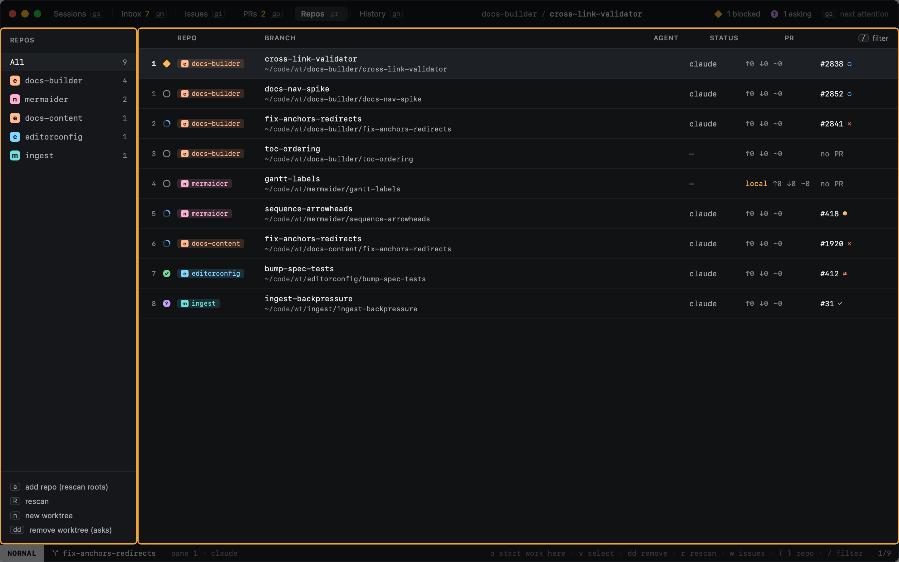
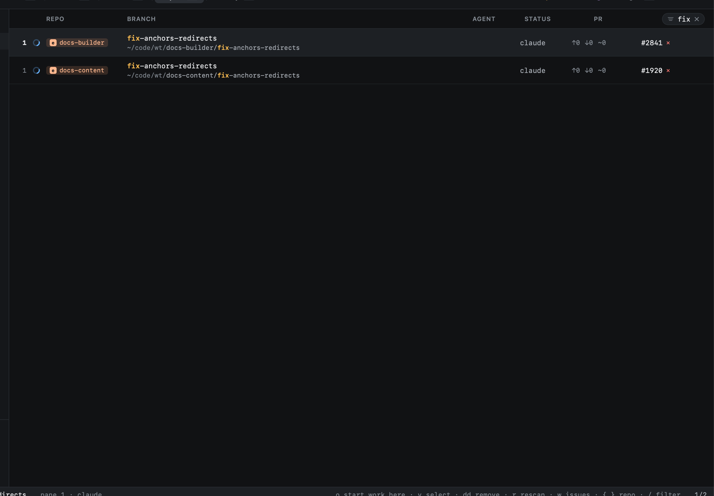

# Worktrees

`gr` opens Repos: every repo Heed knows, and every worktree added to them.

The table shows each worktree's repo, its branch with its path small below, the agent of the session working there, its
status (upstream, ahead, behind, uncommitted changes) and its pull request.

| Key | |
|---|---|
| `↩` | Open the worktree's session, or [import](importing.md) it when it has none |
| `o` | Start work in the repo under the cursor |
| `dd` | [Remove](removing.md) the worktree (asks first) |
| `v` | Select rows, then `d` remove, `y` copy paths, `o` open or import |
| `w` | Flip the repo between all issues and only yours ([Issues](../github/issues.md)) |
| `r` | Refresh: rescan for repos |
| `:repo.add <path>` | Add a repo outside the scanned folders; it is kept in `repo_paths` |
| `{` `}` | Previous / next repo |
| `/` | [Filter](../sessions/filtering.md) by repo, branch, path or agent |

A filter matches the part of a path below its root (the worktree root or a repo root from `[worktrees]`, else your home
folder), so `code` does not match every worktree under `~/code`. What matched is marked in the repo, the branch and the
path.

- [Repos](repos.md): where repos come from, and their order and colours.
- [Importing](importing.md): worktrees made outside Heed, and any path.
- [Removing](removing.md): what is removed, and what never is.
