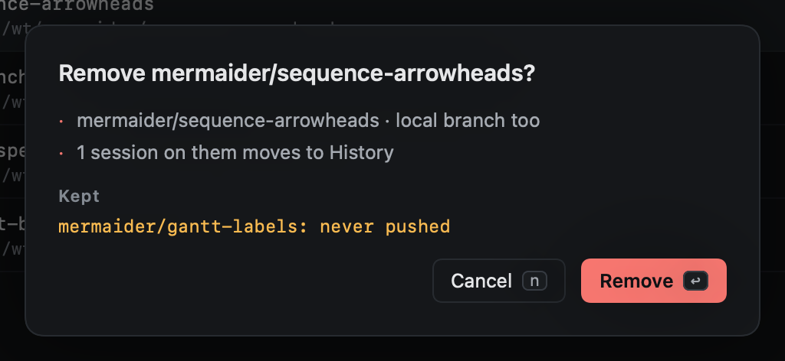

# Removing

`dd` on a worktree in Repos removes it; `v` to select several, then `d`. A confirmation lists what will go, and what
will be kept and why.

Removing a worktree also removes its local branch; the branch on GitHub is left alone. Sessions working there move to History.

## Never removed

- A worktree with **uncommitted changes**.
- A worktree with **unpushed commits**, or a branch that was **never pushed**.
- A worktree whose status is **unknown**.
- A worktree used by a **pinned** session.

The same rules hold for [deleting a session](../sessions/pin-park-close-delete.md).
