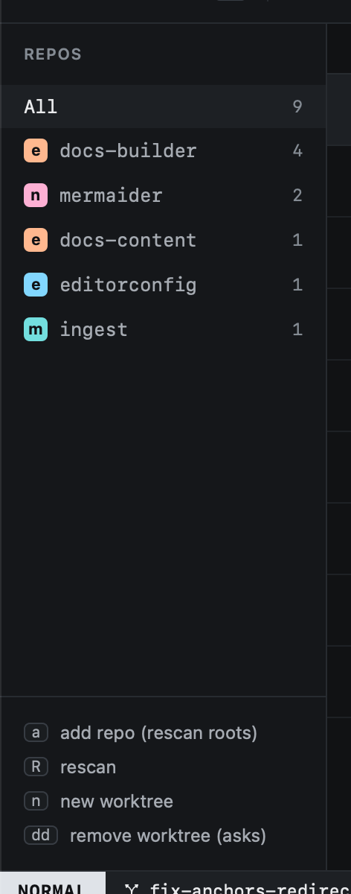

# Repos

Heed scans `repo_roots` (two levels deep) for git repositories, and lists every worktree added to them.

```toml
[worktrees]
repo_roots = ["~/Projects", "~/code"]
repo_paths = []          # repos outside the roots, added when you import one of their worktrees by path
```



- **Order.** Repos with the most worktrees come first, then by name; the worktree table groups rows in the same
  order, and Start work ranks those repos higher too.
- **Colours.** Every repo gets a colour picked from its org's name. Set one in Settings (`⌘,`) or in `config.toml`:

```toml
[repos."elastic/docs-builder"]
color = "orange"    # teal, pink, lime, orange, periwinkle, sky
```

Org avatars are fetched once and cached; repos without a GitHub remote get a letter tile.
